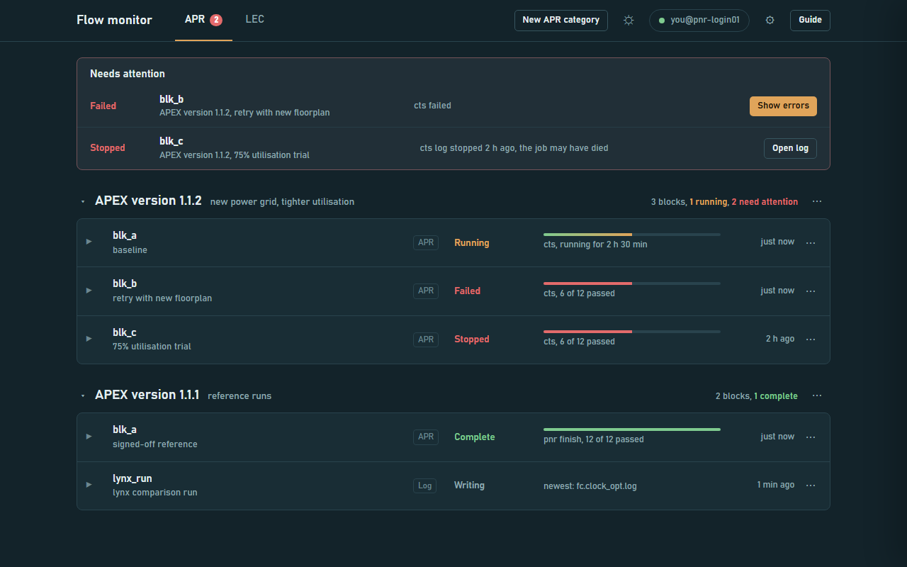
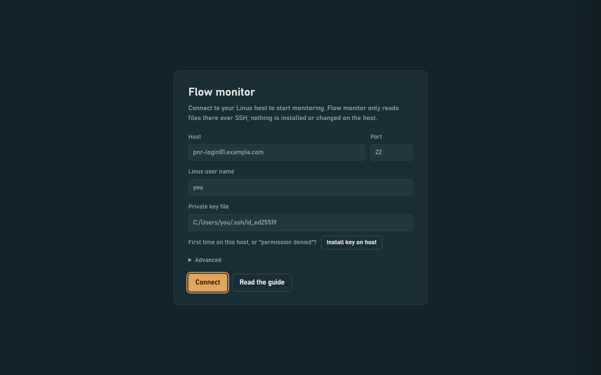
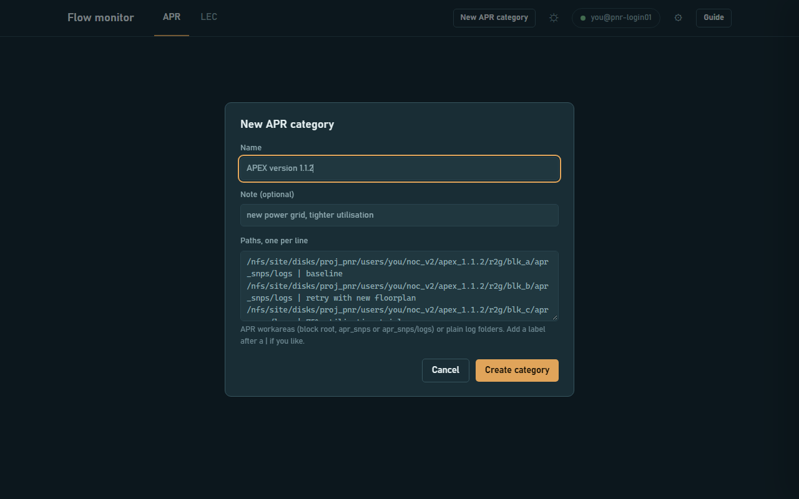
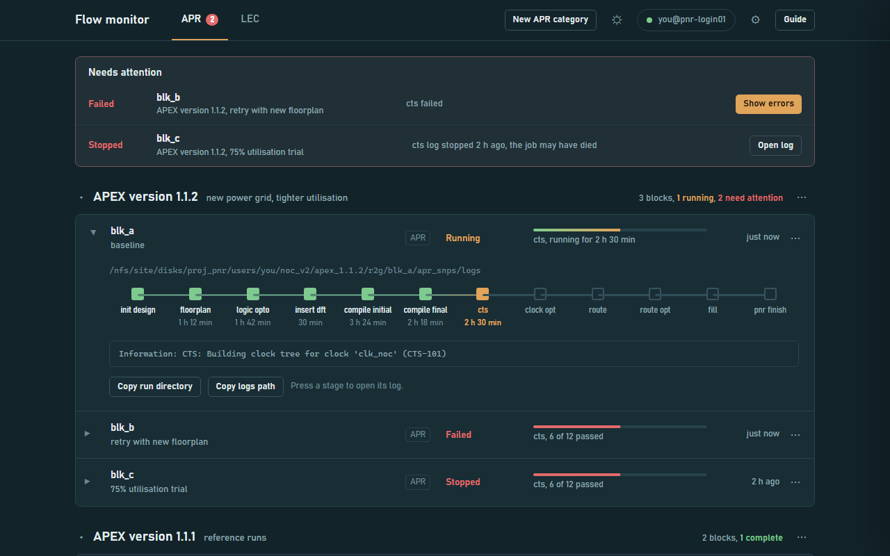
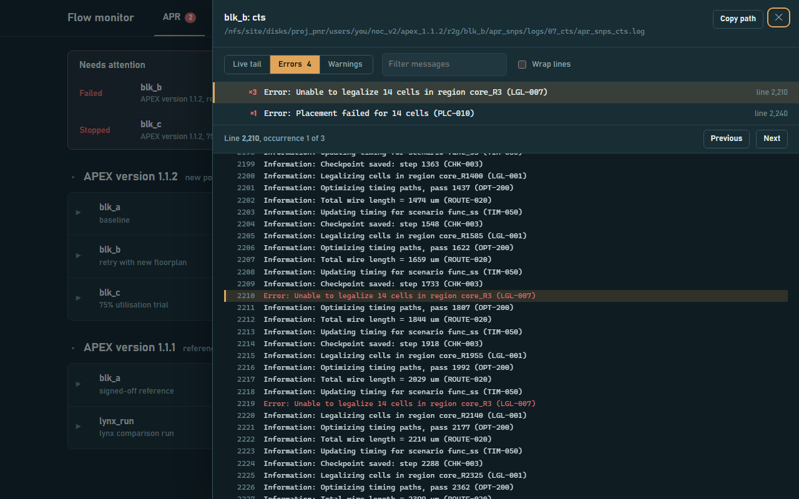
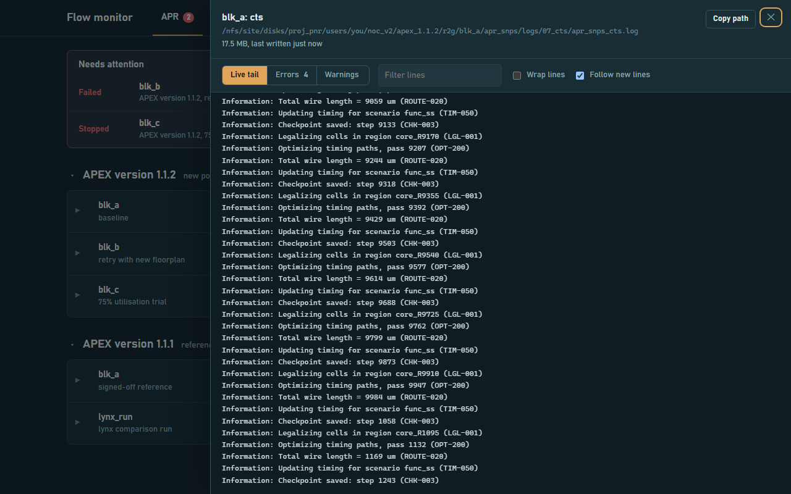
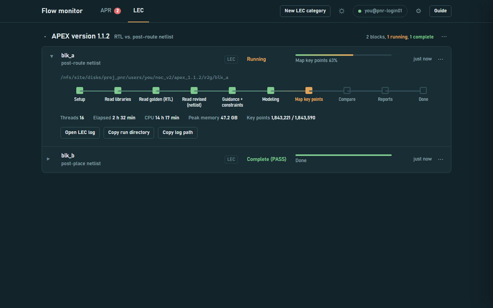
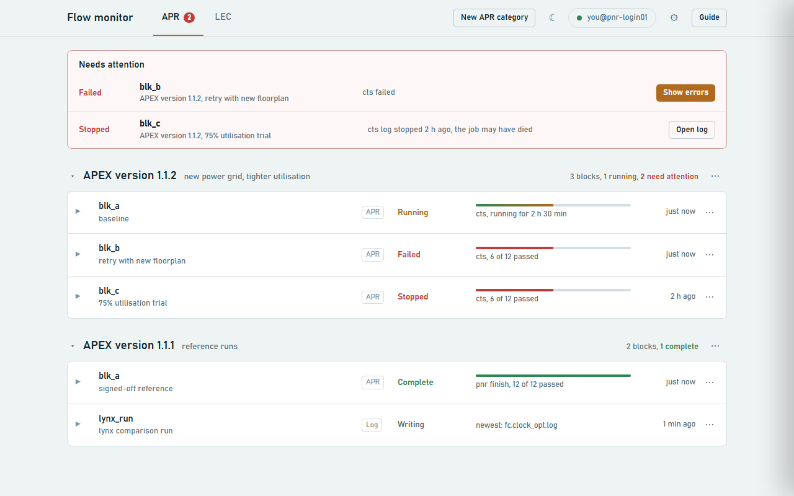

# Flow monitor

Watch your **APR** and **LEC** runs on the Linux host from your Windows desktop in Google Chrome,
and jump straight to the error lines when something breaks.



- Group blocks into categories (for example `APEX version 1.1.2`) with your own labels.
- One quiet line per block; failed, stopped and silent runs are collected in **Needs attention**.
- Stage pipeline with run times, so you can tell a slow stage from a stuck one.
- Log viewer with live tail, and **Errors / Warnings** views over the whole file with repeats grouped and counted.
- Alerts (banner, Windows notification, alarm sound), dark and light themes, custom accent colour.

It is **read-only**: nothing is installed on the Linux host, nothing there is changed, and no website is hosted anywhere.

## How it works (and why the address is 127.0.0.1)

```
Chrome  --http-->  monitor_bridge.py (your PC)  --ssh-->  Linux host (reads files only)
        127.0.0.1:8899
```

A web page can't open SSH connections, so a small helper, `monitor_bridge.py`, runs **on your own PC**.
It opens one SSH session with your key, sends a small read-only scanner over that session
(`apex_monitor.py` + `remote_agent.py`; nothing is written to the host's disk), and serves the page to Chrome.
`127.0.0.1` simply means "this computer", so `http://127.0.0.1:8899` is only reachable from your own PC.

## Requirements

- Windows 10 or 11 with the OpenSSH client (built in on most PCs; `start_monitor.bat` checks and tells you how to add it).
- Python 3.8 or newer from [python.org](https://www.python.org/downloads/) (standard library only, nothing to `pip install`).
- Google Chrome.
- SSH **key** login to the Linux host, and `python3` (3.6 or newer) on that host.

## Setup (once)

1. **Get the code.** Clone or download this repository anywhere on your PC.
2. **Install Python** if you don't have it. `start_monitor.bat` checks and, if Python is missing, tells you where to get it.
3. **SSH key: the page helps you.** The helper finds an existing key in `C:\Users\<you>\.ssh` by itself
   (`id_ed25519`, `id_rsa` or `id_ecdsa`). On the connect screen (or later in **Settings**):
   - no key yet: press **Create a key** (makes `id_ed25519`, no passphrase, so the monitor can use it unattended);
   - first time on a host, or "permission denied": press **Install key on host**. A PowerShell window opens; type your
     Linux password there once. Your password never goes through the page.

   Prefer doing it by hand? In PowerShell:
   ```powershell
   ssh-keygen -t ed25519
   type $env:USERPROFILE\.ssh\id_ed25519.pub | ssh your_user@your-linux-host "mkdir -p ~/.ssh && cat >> ~/.ssh/authorized_keys"
   ```
   Afterwards `ssh your_user@your-linux-host` must log in without asking for a password.
4. **Optional: pre-fill your connection.** Copy `monitor_config.example.json` to `monitor_config.json` and fill in your host,
   user and key path. Or just type them on the connect screen; the page writes `monitor_config.json` for you.

### Where your settings are saved

Everything you set up (connection, categories, paths, labels, alert times, theme) is saved in **`monitor_config.json`**
next to `start_monitor.bat`. Copy it to back it up or to move to another PC. It is personal, so `.gitignore` keeps it out of git;
only `monitor_config.example.json` is shared.

## Step-by-step guide

The same guide is built into the page: press **Guide** in the top bar.

### 1. Start the monitor

Double-click **`start_monitor.bat`**. It first checks that Python and the Windows SSH client are installed, and tells you
what to do if either is missing. Then a minimised window called *Flow monitor bridge* appears (that's the helper),
and the monitor opens in its own window (Chrome, or Edge if Chrome isn't installed) at `http://127.0.0.1:8899`.
**Closing either window stops both.** Running the `.bat` again replaces an older helper and its window with fresh ones.

### 2. Connect to the Linux host

The page opens on **Connect to your Linux host**. Fill in the host and your Linux user name (your key is found automatically)
and press **Connect**. The monitoring page appears once SSH works, and next time it connects by itself.
To change host later, use **Settings** (gear icon or the connection pill).



### 3. Add a category and paste your blocks

Pick the **APR** or **LEC** tab and press **New category**. Paste one path per line; add a label after a `|`:

```
/nfs/site/disks/.../r2g/blk_a/apr_snps/logs | baseline
/nfs/site/disks/.../r2g/blk_b/apr_snps/logs | retry with new floorplan
```

- **APR** accepts a block root, its `apr_snps` folder or `apr_snps/logs`.
- **LEC** accepts a block root, `lec/<block>` or `lec/<block>/logs`.
- Plain log folders (for example a Lynx `apr_fc/logs`) work in either tab and are tagged *Log*.
- A path pasted into the wrong tab tells you which tab it belongs in.



### 4. Read the overview

| Status | Meaning |
|---|---|
| Running | A stage log changed recently and the stage has no pass or fail file yet. |
| Failed | A stage wrote a `.fail` file. |
| Stopped | The current stage's log stopped changing with no pass or fail file; the job was probably killed. |
| Complete | The last stage passed. |
| Idle | Nothing running or failed; the next stage hasn't started. |
| Silent | A watched log folder hasn't been written for longer than its alert time. |
| Path problem | The path doesn't exist on the host, or belongs in the other tab. |

### 5. Look inside a block

Click a line. Stages are drawn as a wire (green passed, orange running, red failed, hollow not started) with each stage's
run time underneath. Press a stage to open its log; **Copy run directory** puts the path on your clipboard for your terminal.



### 6. Debug a failure

Press **Show errors** (in Needs attention, or on the failed block). The log opens on **Errors**: every error in the whole file,
repeats grouped and counted, in the order they first happened. Click a message to see the lines around it;
**Previous / Next** (or `p` / `n`) steps through each occurrence. **Warnings** works the same way.
Error lines are matched the way the flows themselves do (`^Error`, `^INTEL_ERROR`, `^Fatal`, `^INTEL_FATAL`, plus Conformal's `// Error`).



### 7. Follow a running stage

**Live tail** shows the end of the log and follows new lines. Use **Filter** to keep only matching lines; **Esc** closes the panel.



### 8. LEC runs

The **LEC** tab has its own categories and shows the Conformal phase, progress, key points, run time, memory and the
`lec_summary.rpt` result.



### 9. Alerts, themes and settings

Fails, stops, completions and silent log folders raise a banner, a Windows notification and an alarm sound
(toggle each in Settings). The sun/moon button switches light and dark; **Settings → Appearance** also has
*Follow Windows* and a custom accent colour.



## Troubleshooting

| Problem | Fix |
|---|---|
| "Permission denied" | Check the user name, then press **Install key on host** in Settings. |
| "Key file not found" | Clear the key field in Settings to let it find your key, or press **Create a key**. |
| "Host name not found" / timeout | Check VPN and the host name. |
| Remote Python not found | Set **Remote Python command** in Settings, e.g. `/usr/bin/python3`. |
| Everything stuck on "Checking" | Run `start_monitor.bat` again (it replaces an out-of-date helper). |
| "Flow monitor has stopped" | The helper window was closed; run `start_monitor.bat`. |
| `python` opens the Microsoft Store | The launcher uses `py -3`; install Python from python.org with the launcher option ticked. |

To start over, close the helper window and delete `monitor_config.json`.

## Files

| File | What it is |
|---|---|
| `start_monitor.bat` | Starts the helper and opens Chrome. |
| `monitor_bridge.py` | The desktop helper: one SSH session, serves the page on 127.0.0.1:8899. |
| `monitor.html` | The page itself. |
| `remote_agent.py` | Read-only request loop sent to the Linux host over SSH. |
| `apex_monitor.py` | APR and LEC scanning logic (also runs standalone on Linux as its own dashboard). |
| `monitor_config.example.json` | Template for your personal `monitor_config.json`. |
| `monitor_config.json` | Your saved connection, categories and settings (created for you, never committed). |
| `docs/images/` | Screenshots used by this README and the in-page guide (demo data). |

## Adding another flow later (e.g. STA)

Add an entry to `FLOWS` in `monitor.html`, and a resolver plus scanner for it in `remote_agent.py`
(`FLOW_RESOLVERS` and `scan_items`). Tabs, categories, alerts and the log viewer work unchanged.
